# 画面遷移・操作フローチャート（編集用）

70組の操作を「選択→確認→終了」で整理。3段階は独立した3画面を意味しません。画面のURLを各段階に併記し、同画面操作とダイアログを区別しています。

## 全体構成

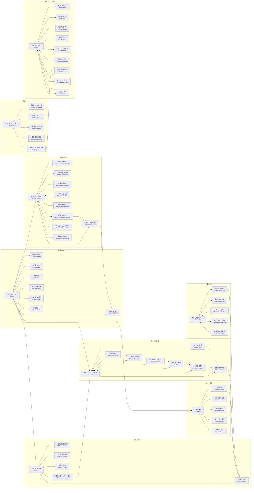

共通のメインナビは各画面から地図・検索・通報・避難情報・お気に入りへ、利用者アイコンは設定へ接続します。全ての組合せを図に重ねると読みにくいため、この共通規則を併記しています。外部サイト・電話・通知・ダイアログはURL画面とは別です。

## F01 地図の基本閲覧

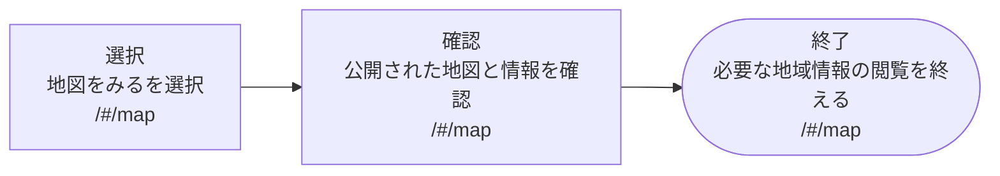

補足：同じ地図画面での閲覧操作。

## F02 現在地周辺を確認

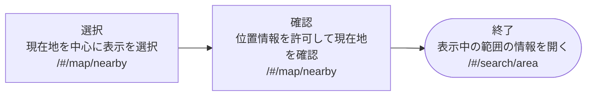

補足：拒否・取得失敗時は同じ画面にメッセージ。現在地だけではサーバーへ保存しない。

## F03 交通の危険箇所を確認

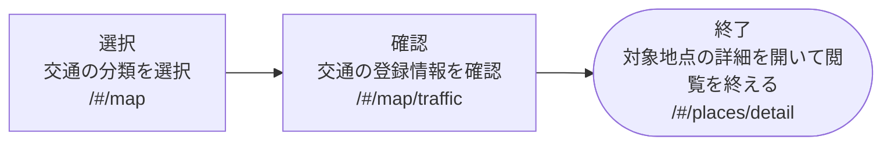

補足：対象地点がある場合。0件の場合は案内を表示。

## F04 防犯の登録情報を確認

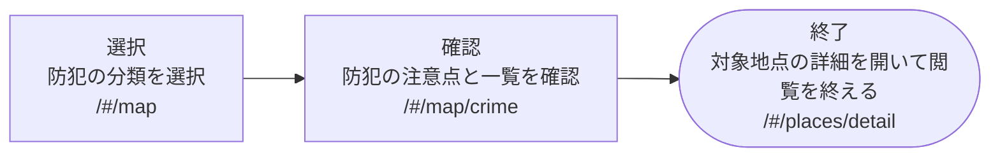

補足：対象地点がある場合。

## F05 災害の注意箇所を確認

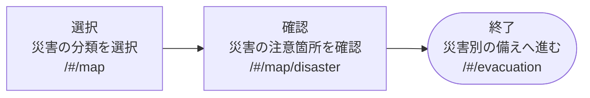

補足：地図情報から防災ガイドへ接続。

## F06 設備の不具合を確認

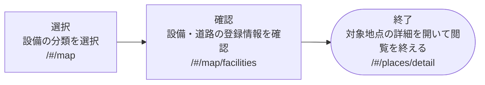

補足：対象地点がある場合。

## F07 対応済みの場所を確認

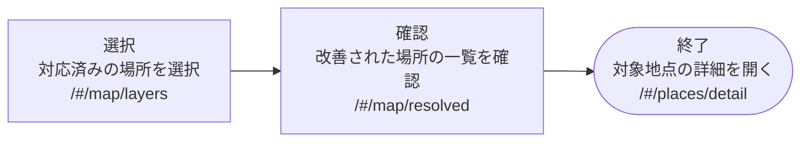

補足：対応済みの登録情報がある場合。

## F08 地図の背景を切り替える

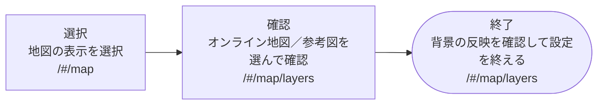

補足：ラジオボタンで即時反映。独立した保存完了ページはない。

## F09 キーワード検索

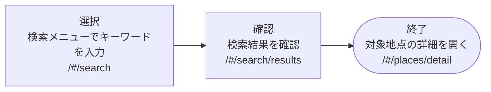

補足：名称・メモを検索。住所からの位置特定ではない。

## F10 検索結果から地点を選ぶ

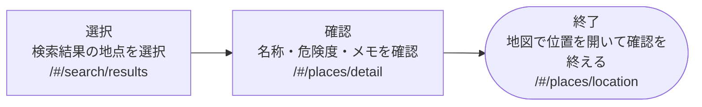

補足：対象地点IDを引き継ぐ。

## F11 条件による絞り込み

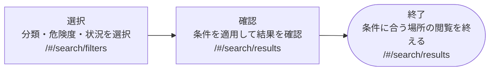

補足：結果が0件なら条件を変更できる。

## F12 検索履歴を利用

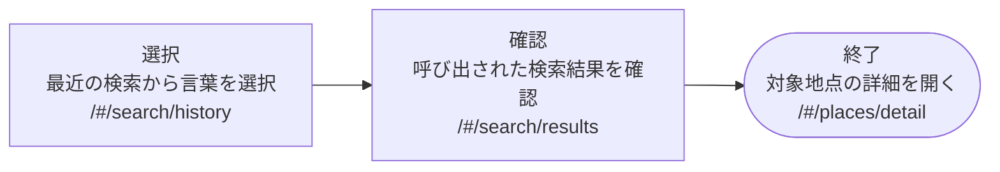

補足：履歴はこのブラウザーに保存。

## F13 表示エリアで探す

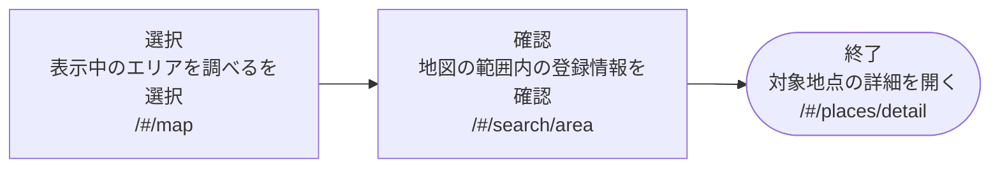

補足：地図を動かすと対象一覧を更新。

## F14 保存した検索を利用

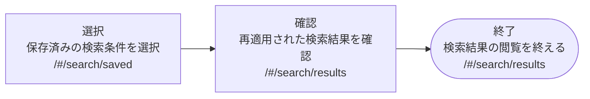

補足：検索結果の保存ボタンで事前保存が必要。

## F15 登録地点の一覧を確認

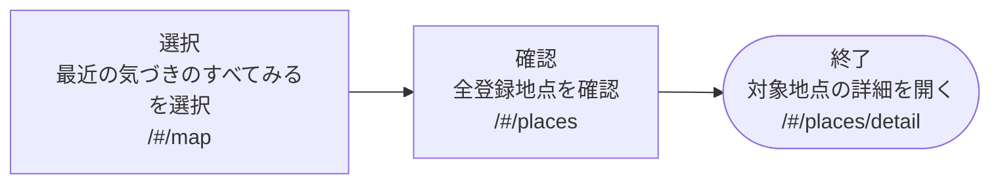

補足：登録情報がない場合は通報へ案内。

## F16 危険箇所の詳細を確認

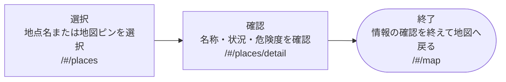

補足：ヘッダーのホーム／地図リンクで戻れる。

## F17 危険箇所の位置を確認

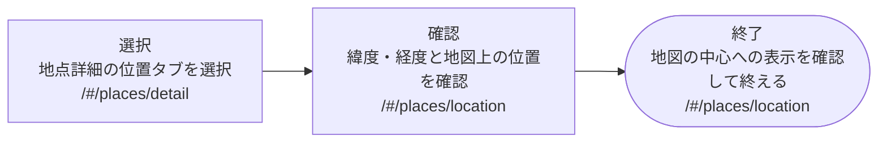

補足：中心移動は同画面の地図操作。

## F18 危険箇所の更新を確認

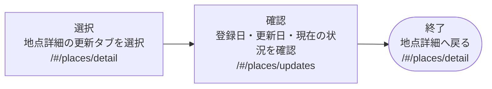

補足：過去の全操作履歴は管理者専用。

## F19 地点リンクを共有

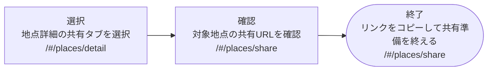

補足：コピー結果は通知。自動送信はしない。

## F20 地点別の注意点を確認

```mermaid
flowchart LR
  F20A["選択<br/>地点詳細の注意点タブを選択<br/>/#/places/detail"] --> F20B["確認<br/>分類に合う安全行動を確認<br/>/#/places/caution"] --> F20C(["終了<br/>必要に応じて連絡先を開く<br/>/#/evacuation/contacts"])
```

補足：登録情報は現地の安全を保証しない。

## F21 通報を開始

```mermaid
flowchart LR
  F21A["選択<br/>通報するを選択<br/>/#/map"] --> F21B["確認<br/>通報の流れと注意事項を確認<br/>/#/report"] --> F21C(["終了<br/>通報する場所の選択へ進む<br/>/#/report/location"])
```

補足：この段階ではサーバーに送信しない。

## F22 通報する位置を決める

```mermaid
flowchart LR
  F22A["選択<br/>地図クリックまたは座標を入力<br/>/#/report/location"] --> F22B["確認<br/>選択位置と緯度・経度を確認<br/>/#/report/location"] --> F22C(["終了<br/>種類の選択へ進む<br/>/#/report/category"])
```

補足：地図の中心を選ぶ操作も可能。入力不備なら同じ画面で修正。

## F23 通報の分類を決める

```mermaid
flowchart LR
  F23A["選択<br/>分類と気になる度合いを選択<br/>/#/report/category"] --> F23B["確認<br/>選択内容を確認<br/>/#/report/category"] --> F23C(["終了<br/>詳細の入力へ進む<br/>/#/report/details"])
```

補足：分類は交通・防犯・災害・設備・その他。

## F24 通報の詳細を入力

```mermaid
flowchart LR
  F24A["選択<br/>場所の名称と状況を入力<br/>/#/report/details"] --> F24B["確認<br/>入力内容を確認する操作を選択<br/>/#/report/details"] --> F24C(["終了<br/>通報内容の確認画面を開く<br/>/#/report/review"])
```

補足：必須入力・文字数の検証あり。

## F25 通報を送信

```mermaid
flowchart LR
  F25A["選択<br/>送信する通報を選ぶ<br/>/#/report/review"] --> F25B["確認<br/>内容と個人情報がないことを確認<br/>/#/report/review"] --> F25C(["終了<br/>送信して受付結果を表示<br/>/#/report/complete"])
```

補足：未選択の座標は位置画面へ、空の名称・状況は詳細画面へ戻る。送信失敗時は確認画面に留まる。

## F26 通報受付を確認

```mermaid
flowchart LR
  F26A["選択<br/>今回の受付結果を開く<br/>/#/report/complete"] --> F26B["確認<br/>受付番号と受付完了を確認<br/>/#/report/complete"] --> F26C(["終了<br/>確認状況を開く<br/>/#/report/status"])
```

補足：実際に送信成功した受付が対象。送信後の再読み込みでは履歴から確認。

## F27 通報履歴を確認

```mermaid
flowchart LR
  F27A["選択<br/>この端末からの通報履歴を選択<br/>/#/report"] --> F27B["確認<br/>保存された受付記録を確認<br/>/#/report/history"] --> F27C(["終了<br/>対象通報の確認状況を開く<br/>/#/report/status"])
```

補足：別端末の受付記録は表示されない。

## F28 通報の対応状況を確認

```mermaid
flowchart LR
  F28A["選択<br/>履歴から対象の受付を選択<br/>/#/report/history"] --> F28B["確認<br/>確認待ち・公開・見送りを確認<br/>/#/report/status"] --> F28C(["終了<br/>確認を終えて通報履歴へ戻る<br/>/#/report/history"])
```

補足：公開済みの場合のみ公開地点へのリンクが出る。

## F29 防災情報を探す

```mermaid
flowchart LR
  F29A["選択<br/>避難・防災メニューを選択<br/>/#/map"] --> F29B["確認<br/>災害の種類と利用できる機能を確認<br/>/#/evacuation"] --> F29C(["終了<br/>必要な防災ガイドを開く<br/>/#/evacuation/earthquake"])
```

補足：地震は選択先の一例。洪水・台風・火災にも進める。

## F30 地震への備えを確認

```mermaid
flowchart LR
  F30A["選択<br/>地震を選択<br/>/#/evacuation"] --> F30B["確認<br/>揺れたときの行動を確認<br/>/#/evacuation/earthquake"] --> F30C(["終了<br/>持ち出し品の確認へ進む<br/>/#/evacuation/checklist"])
```

補足：リアルタイムの地震情報を表示する画面ではない。

## F31 大雨・洪水への備えを確認

```mermaid
flowchart LR
  F31A["選択<br/>大雨・洪水を選択<br/>/#/evacuation"] --> F31B["確認<br/>浸水リスクと避難判断の考え方を確認<br/>/#/evacuation/flood"] --> F31C(["終了<br/>持ち出し品の確認へ進む<br/>/#/evacuation/checklist"])
```

補足：最新の警報は気象庁への外部リンクで確認。

## F32 台風への備えを確認

```mermaid
flowchart LR
  F32A["選択<br/>台風を選択<br/>/#/evacuation"] --> F32B["確認<br/>接近前の準備を確認<br/>/#/evacuation/typhoon"] --> F32C(["終了<br/>持ち出し品の確認へ進む<br/>/#/evacuation/checklist"])
```

補足：最新の進路・警報は気象庁で確認。

## F33 火災時の行動を確認

```mermaid
flowchart LR
  F33A["選択<br/>火災を選択<br/>/#/evacuation"] --> F33B["確認<br/>通報・初期消火・避難の考え方を確認<br/>/#/evacuation/fire"] --> F33C(["終了<br/>備えのチェックへ進む<br/>/#/evacuation/checklist"])
```

補足：実際の火災時は安全な場所から119番。

## F34 避難先の調べ方を確認

```mermaid
flowchart LR
  F34A["選択<br/>避難先を調べるを選択<br/>/#/evacuation"] --> F34B["確認<br/>避難場所・避難所の違いと公式リンクを確認<br/>/#/evacuation/shelters"] --> F34C(["終了<br/>避難先のメモ作成へ進む<br/>/#/evacuation/shelter-detail"])
```

補足：公式サイトは外部ページ。避難所の開設状況を独自に配信しない。

## F35 避難先メモを保存

```mermaid
flowchart LR
  F35A["選択<br/>避難先の名称とメモを入力<br/>/#/evacuation/shelter-detail"] --> F35B["確認<br/>入力した内容を読み直す<br/>/#/evacuation/shelter-detail"] --> F35C(["終了<br/>端末にメモを保存して終了<br/>/#/evacuation/shelter-detail"])
```

補足：保存ボタンで即時保存し通知。別の確認・完了ページはない。

## F36 避難経路の注意点を確認

```mermaid
flowchart LR
  F36A["選択<br/>避難するときの確認を選択<br/>/#/evacuation/shelter-detail"] --> F36B["確認<br/>経路判断の注意点を確認<br/>/#/evacuation/route"] --> F36C(["終了<br/>災害の注意箇所を開く<br/>/#/map/disaster"])
```

補足：安全なルートを自動計算する機能はない。

## F37 持ち出し品を確認

```mermaid
flowchart LR
  F37A["選択<br/>持ち出しチェックリストを選択<br/>/#/evacuation"] --> F37B["確認<br/>準備した品にチェックして内容を確認<br/>/#/evacuation/checklist"] --> F37C(["終了<br/>チェックの端末保存を確認して終了<br/>/#/evacuation/checklist"])
```

補足：チェックは即時保存。リセットも同画面。

## F38 緊急連絡先を確認

```mermaid
flowchart LR
  F38A["選択<br/>緊急時の連絡先を選択<br/>/#/evacuation"] --> F38B["確認<br/>消防・警察・伝言ダイヤルを確認<br/>/#/evacuation/contacts"] --> F38C(["終了<br/>必要な番号の通話機能を開く<br/>端末の通話機能"])
```

補足：tel:リンクで端末の通話機能へ。発信完了はサイトでは確認しない。

## F39 保存内容の入口を確認

```mermaid
flowchart LR
  F39A["選択<br/>保存メニューを選択<br/>/#/map"] --> F39B["確認<br/>場所・エリア・コレクションを確認<br/>/#/favorites"] --> F39C(["終了<br/>保存した場所の一覧を開く<br/>/#/favorites/places"])
```

補足：保存内容はブラウザー内にあり端末間同期はない。

## F40 保存した場所を確認

```mermaid
flowchart LR
  F40A["選択<br/>保存した場所を選択<br/>/#/favorites"] --> F40B["確認<br/>お気に入りの地点一覧を確認<br/>/#/favorites/places"] --> F40C(["終了<br/>対象地点の詳細を開く<br/>/#/places/detail"])
```

補足：事前にハートで保存した地点が必要。

## F41 エリアを保存

```mermaid
flowchart LR
  F41A["選択<br/>地図の表示範囲に名前を入力<br/>/#/favorites/areas"] --> F41B["確認<br/>エリア名と保存対象を確認<br/>/#/favorites/areas"] --> F41C(["終了<br/>表示中のエリアを保存して終了<br/>/#/favorites/areas"])
```

補足：保存後に一覧へ即時反映。別の確認・完了ページはない。

## F42 コレクションを作成

```mermaid
flowchart LR
  F42A["選択<br/>コレクション名を入力<br/>/#/favorites/collections"] --> F42B["確認<br/>名称を確認して作成を選択<br/>/#/favorites/collections"] --> F42C(["終了<br/>作成したコレクションを開く<br/>/#/favorites/collection"])
```

補足：作成後に新しいコレクションIDを引き継ぐ。

## F43 コレクションの場所を選ぶ

```mermaid
flowchart LR
  F43A["選択<br/>対象コレクションを選択<br/>/#/favorites/collections"] --> F43B["確認<br/>含めるお気に入り地点を選んで確認<br/>/#/favorites/collection"] --> F43C(["終了<br/>更新の通知を確認して終了<br/>/#/favorites/collection"])
```

補足：チェック変更で即時保存。別の確定ボタンはない。

## F44 お気に入りを整理

```mermaid
flowchart LR
  F44A["選択<br/>保存内容を整理を選択<br/>/#/favorites"] --> F44B["確認<br/>不要な地点・コレクションを確認<br/>/#/favorites/manage"] --> F44C(["終了<br/>解除・削除して一覧の更新を確認<br/>/#/favorites/manage"])
```

補足：現在は確認ダイアログなしで即時反映。資料内に架空の確認画面を置かない。

## F45 設定項目を探す

```mermaid
flowchart LR
  F45A["選択<br/>利用者アイコンを選択<br/>/#/map"] --> F45B["確認<br/>設定項目を確認<br/>/#/settings"] --> F45C(["終了<br/>表示と文字サイズを開く<br/>/#/settings/display"])
```

補足：表示設定は選択先の一例。ほかの設定にも進める。

## F46 文字と動きを設定

```mermaid
flowchart LR
  F46A["選択<br/>文字サイズ・動きの設定を選択<br/>/#/settings/display"] --> F46B["確認<br/>表示の変化を確認<br/>/#/settings/display"] --> F46C(["終了<br/>設定を端末に保存して終了<br/>/#/settings/display"])
```

補足：トグル変更時に即時保存。

## F47 プライバシーを確認

```mermaid
flowchart LR
  F47A["選択<br/>プライバシーを選択<br/>/#/settings"] --> F47B["確認<br/>公開情報と端末保存の説明を確認<br/>/#/settings/privacy"] --> F47C(["終了<br/>保存データの管理を開く<br/>/#/settings/data"])
```

補足：説明を読んで削除等の操作へ移れる。

## F48 端末内データを削除

```mermaid
flowchart LR
  F48A["選択<br/>端末内の保存データを削除を選択<br/>/#/settings/data"] --> F48B["確認<br/>削除内容を確認ダイアログで確認<br/>端末データ削除の確認ダイアログ"] --> F48C(["終了<br/>削除を確定して通知を確認<br/>/#/settings/data"])
```

補足：キャンセルなら変更せず設定に戻る。サーバーの地点・通報は削除しない。

## F49 位置情報の利用を確認

```mermaid
flowchart LR
  F49A["選択<br/>現在地を取得するを選択<br/>/#/settings/location"] --> F49B["確認<br/>ブラウザーの利用許可を確認<br/>ブラウザーの位置情報許可"] --> F49C(["終了<br/>許可できた現在地の表示を確認<br/>/#/settings/location"])
```

補足：拒否・非対応・タイムアウトなら通知して同画面に留まる。

## F50 サービス情報を確認

```mermaid
flowchart LR
  F50A["選択<br/>このサービスについてを選択<br/>/#/settings"] --> F50B["確認<br/>サービスの目的と案内を確認<br/>/#/settings/about"] --> F50C(["終了<br/>情報の出典を開く<br/>/#/help/sources"])
```

補足：管理者ページへのリンクもある。

## F51 ヘルプを探す

```mermaid
flowchart LR
  F51A["選択<br/>使い方を選択<br/>/#/settings"] --> F51B["確認<br/>知りたい案内を確認<br/>/#/help"] --> F51C(["終了<br/>はじめての方への案内を開く<br/>/#/help/start"])
```

補足：各画面のフッターからヘルプへ進める。

## F52 はじめての使い方を確認

```mermaid
flowchart LR
  F52A["選択<br/>はじめての方へを選択<br/>/#/help"] --> F52B["確認<br/>閲覧・通報・保存の使い方を確認<br/>/#/help/start"] --> F52C(["終了<br/>地図をみるを選んで操作を始める<br/>/#/map"])
```

補足：案内から実際の機能へのリンク。

## F53 地図の使い方を確認

```mermaid
flowchart LR
  F53A["選択<br/>地図の使い方を選択<br/>/#/help"] --> F53B["確認<br/>移動・拡大・地点選択を確認<br/>/#/help/map"] --> F53C(["終了<br/>現在地の周辺を開く<br/>/#/map/nearby"])
```

補足：対応する機能への案内リンクを使用。

## F54 検索の使い方を確認

```mermaid
flowchart LR
  F54A["選択<br/>検索の使い方を選択<br/>/#/help"] --> F54B["確認<br/>キーワード・絞り込み・保存を確認<br/>/#/help/search"] --> F54C(["終了<br/>検索画面で操作を始める<br/>/#/search"])
```

補足：住所検索ではなく登録内容の検索。

## F55 通報の使い方を確認

```mermaid
flowchart LR
  F55A["選択<br/>通報の流れを選択<br/>/#/help"] --> F55B["確認<br/>送信から管理者確認までを確認<br/>/#/help/report"] --> F55C(["終了<br/>通報する位置の選択を開く<br/>/#/report/location"])
```

補足：この案内の閲覧だけでは通報は送信されない。

## F56 お気に入りの使い方を確認

```mermaid
flowchart LR
  F56A["選択<br/>お気に入りの使い方を選択<br/>/#/help"] --> F56B["確認<br/>保存・エリア・整理方法を確認<br/>/#/help/favorites"] --> F56C(["終了<br/>保存した場所を開く<br/>/#/favorites/places"])
```

補足：ブラウザー内保存という制限も確認。

## F57 緊急時の使い分けを確認

```mermaid
flowchart LR
  F57A["選択<br/>緊急のときはを選択<br/>/#/help"] --> F57B["確認<br/>サイト通報と緊急通報の違いを確認<br/>/#/help/emergency"] --> F57C(["終了<br/>緊急連絡先を開く<br/>/#/evacuation/contacts"])
```

補足：サイトの通報は即時出動の依頼ではない。

## F58 情報の出典を確認

```mermaid
flowchart LR
  F58A["選択<br/>情報の出典と更新を選択<br/>/#/help"] --> F58B["確認<br/>地域情報・地図・公的情報の出典を確認<br/>/#/help/sources"] --> F58C(["終了<br/>登録された場所を開く<br/>/#/places"])
```

補足：更新周期と公的情報を使い分ける。

## F59 見やすさの案内を確認

```mermaid
flowchart LR
  F59A["選択<br/>アクセシビリティを選択<br/>/#/help"] --> F59B["確認<br/>キーボード・文字・地図以外の操作を確認<br/>/#/help/accessibility"] --> F59C(["終了<br/>表示と文字サイズを開く<br/>/#/settings/display"])
```

補足：実際の表示設定への案内リンクを使用。

## F60 サイトマップで機能を探す

```mermaid
flowchart LR
  F60A["選択<br/>ヘルプのサイトマップを選択<br/>/#/help"] --> F60B["確認<br/>目的別の機能の説明を確認<br/>/#/sitemap"] --> F60C(["終了<br/>使いたい機能を開く<br/>/#/search"])
```

補足：検索は選択先の一例。各機能への通常リンクを使用。

## F61 管理者ログイン

```mermaid
flowchart LR
  F61A["選択<br/>管理者ログインを選択<br/>/admin.html"] --> F61B["確認<br/>パスワードを入力して認証を実行<br/>/admin.html｜ログインダイアログ"] --> F61C(["終了<br/>管理者モードへの切り替えを確認<br/>/admin.html"])
```

補足：入力エラー・試行制限・管理者未設定はダイアログ等に表示。

## F62 管理者ログアウト

```mermaid
flowchart LR
  F62A["選択<br/>ログアウトを選択<br/>/admin.html"] --> F62B["確認<br/>ログアウト処理の結果を確認<br/>/admin.html"] --> F62C(["終了<br/>閲覧モードへの切り替えを確認<br/>/admin.html"])
```

補足：独立した確認ページはない。

## F63 危険箇所を登録

```mermaid
flowchart LR
  F63A["選択<br/>新規登録または地図位置を選択<br/>/admin.html"] --> F63B["確認<br/>登録フォームの入力内容を確認<br/>/admin.html｜地点入力ダイアログ"] --> F63C(["終了<br/>保存して地図・一覧への反映を確認<br/>/admin.html"])
```

補足：入力検証に失敗した場合はフォームで修正。

## F64 危険箇所を編集

```mermaid
flowchart LR
  F64A["選択<br/>対象地点の編集を選択<br/>/admin.html"] --> F64B["確認<br/>編集フォームの内容を確認<br/>/admin.html｜地点入力ダイアログ"] --> F64C(["終了<br/>保存して変更を確認<br/>/admin.html"])
```

補足：競合時は409エラー。再取得してやり直す。

## F65 対応状況を更新

```mermaid
flowchart LR
  F65A["選択<br/>対象地点の対応状況を選択<br/>/admin.html"] --> F65B["確認<br/>選択した状況と更新結果を確認<br/>/admin.html"] --> F65C(["終了<br/>一覧・地図への反映を確認<br/>/admin.html"])
```

補足：状況選択で即時更新。独立した確認ページはない。

## F66 危険箇所を削除

```mermaid
flowchart LR
  F66A["選択<br/>対象地点の削除を選択<br/>/admin.html"] --> F66B["確認<br/>対象名をブラウザーの確認で確認<br/>ブラウザーの確認ダイアログ"] --> F66C(["終了<br/>確定して一覧からの削除を確認<br/>/admin.html"])
```

補足：キャンセルなら変更なし。競合の場合は再取得。

## F67 管理者の操作履歴を確認

```mermaid
flowchart LR
  F67A["選択<br/>操作履歴を見るを選択<br/>/admin.html"] --> F67B["確認<br/>登録・更新・削除・通報確認の履歴を確認<br/>/admin.html｜操作履歴ダイアログ"] --> F67C(["終了<br/>閉じるを選んで管理画面へ戻る<br/>/admin.html"])
```

補足：最新200件。一般利用者には公開しない。

## F68 公開データを書き出す

```mermaid
flowchart LR
  F68A["選択<br/>データを書き出すを選択<br/>/admin.html"] --> F68B["確認<br/>対象の公開登録情報を確認<br/>/admin.html"] --> F68C(["終了<br/>JSONのダウンロードを開始して終了<br/>ファイルのダウンロード"])
```

補足：ファイルはcommunity-safety.json。管理者設定・セッションは含めない。

## F69 通報を確認して公開

```mermaid
flowchart LR
  F69A["選択<br/>通報一覧で公開対象を選択<br/>/admin.html｜通報一覧ダイアログ"] --> F69B["確認<br/>内容・位置を読み公開操作を確認<br/>ブラウザーの確認ダイアログ"] --> F69C(["終了<br/>公開して地点一覧への反映を確認<br/>/admin.html"])
```

補足：公開済みの通報を再公開できない。

## F70 通報の公開を見送る

```mermaid
flowchart LR
  F70A["選択<br/>通報一覧で見送る対象を選択<br/>/admin.html｜通報一覧ダイアログ"] --> F70B["確認<br/>内容を読み見送り操作を確認<br/>ブラウザーの確認ダイアログ"] --> F70C(["終了<br/>確定して見送り状態を確認<br/>/admin.html｜通報一覧ダイアログ"])
```

補足：一般の地図には公開されず、送信者は受付記録から状況を確認できる。
